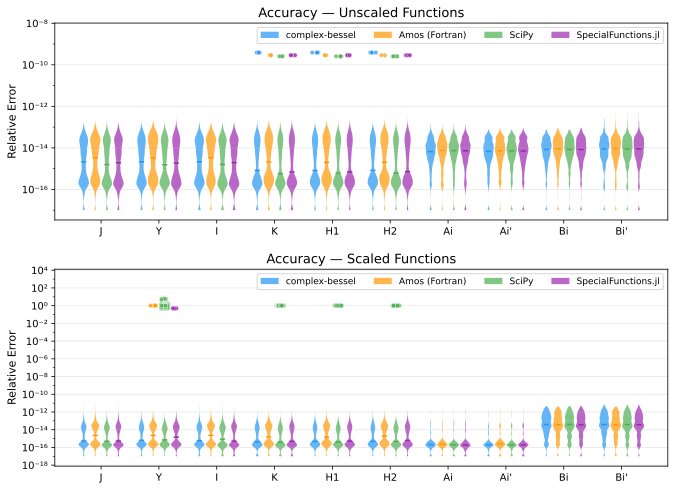
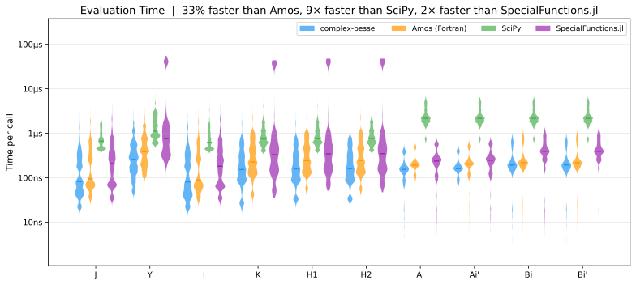
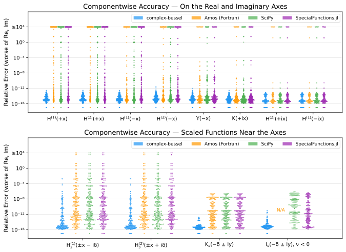

# complex-bessel-test

Accuracy and performance test suite for the [`complex-bessel`](https://github.com/elgar328/complex-bessel) Rust library, comparing against AMOS/TOMS 644 (Fortran), SciPy (Python), SpecialFunctions.jl (Julia), and mpmath (50+ digit precision ground truth).

<!-- versions-start -->Versions: complex-bessel 0.5.0 (Rust), Amos/TOMS 644 (Fortran, gfortran 16.2.0), SciPy 1.18.1 (Python 3.13.2), SpecialFunctions.jl 2.9.2 (Julia 1.13.4); references: mpmath 1.3.0.<!-- versions-end -->

## Accuracy

Relative error of complex-bessel (Rust), AMOS/TOMS 644 (Fortran), SciPy (Python), and SpecialFunctions.jl (Julia) versus mpmath 50+ digit reference values, across all Bessel and Airy functions. Lower is better. Results below 10<sup>-290</sup> (the underflow range, where Amos flushes to zero) and the few grid points where the function is exactly zero are excluded.

[](images/accuracy.pdf)

> **Outliers in unscaled functions (K, H1, H2):**
> The points above 10<sup>-10</sup> come from near-zero results where the relative error is inherently amplified. All four implementations show the same behavior.
>
> **Outliers in scaled functions (SciPy, Fortran, and Julia):**
> SciPy's K<sub>scaled</sub>, H1<sub>scaled</sub>, and H2<sub>scaled</sub> return zero in regions requiring analytic continuation — a code path (AMOS ZACON) that SciPy does not implement. SciPy's Y<sub>scaled</sub> produces incorrect values near the real axis at large orders (ν ≥ 90), with relative errors up to 603%. Rust, Fortran, and Julia handle both cases correctly.
>
> Fortran's Y<sub>scaled</sub> is wrong (relative error 1) for large orders with |Im z| above about 350, e.g. ν = 1000, |Im z| = 500, because ZBESY drops a dominant term there as an underflow. SpecialFunctions.jl is wrong at the same points (relative error 0.5). complex-bessel keeps this term.

## Evaluation Time

Median evaluation time per function call, measured over 1000 repetitions per point. Lower is better. <!-- bench-speedup-start -->On average across all functions, complex-bessel is **33% faster** than Amos, **9× faster** than SciPy, and **2× faster** than SpecialFunctions.jl.<!-- bench-speedup-end -->

[](images/eval_time.pdf)

> SpecialFunctions.jl reports an error (e.g. overflow at small |z|, or z = 0) by throwing an exception, which takes about 50 μs: these are its points near the top for Y, K, H1, and H2. The others return an error code.

<!-- bench-env-start -->
> Measured on Apple M4 Max.
<!-- bench-env-end -->

## Summary

<!-- summary-table-start -->
**Unscaled Functions**

| Func | Points | Ok / Warn / Err | Match (%) | Rel Err | Time (μs) |
|:----:|:------:|:---------------:|:---------:|:-------:|:---------:|
| J | 28749 | 28747 / 0 / 2 | 100.0 | 2.1e-15 | 0.09 |
| Y | 28749 | 25514 / 0 / 3235 | 100.0 | 2.1e-15 | 0.27 |
| I | 28749 | 28747 / 0 / 2 | 100.0 | 2.1e-15 | 0.09 |
| K | 28749 | 25512 / 0 / 3237 | 100.0 | 8.1e-16 | 0.16 |
| H1 | 28749 | 25512 / 0 / 3237 | 100.0 | 8.0e-16 | 0.17 |
| H2 | 28749 | 25512 / 0 / 3237 | 100.0 | 8.3e-16 | 0.17 |
| Ai | 28749 | 28749 / 0 / 0 | 100.0 | 6.6e-15 | 0.16 |
| Ai' | 28749 | 28749 / 0 / 0 | 100.0 | 6.7e-15 | 0.17 |
| Bi | 28749 | 28749 / 0 / 0 | 100.0 | 8.5e-15 | 0.21 |
| Bi' | 28749 | 28749 / 0 / 0 | 100.0 | 8.9e-15 | 0.21 |

**Scaled Functions**

| Func | Points | Ok / Warn / Err | Match (%) | Rel Err | Time (μs) |
|:----:|:------:|:---------------:|:---------:|:-------:|:---------:|
| J | 13125 | 13125 / 0 / 0 | 100.0 | 5.2e-16 | 0.08 |
| Y | 13125 | 12273 / 0 / 852 | 100.0 | 6.2e-16 | 0.21 |
| I | 13125 | 13125 / 0 / 0 | 100.0 | 5.7e-16 | 0.07 |
| K | 13125 | 12273 / 0 / 852 | 100.0 | 4.4e-16 | 0.14 |
| H1 | 13125 | 12273 / 0 / 852 | 100.0 | 4.7e-16 | 0.15 |
| H2 | 13125 | 12273 / 0 / 852 | 100.0 | 4.9e-16 | 0.15 |
| Ai | 13125 | 12705 / 420 / 0 | 100.0 | 2.1e-16 | 0.13 |
| Ai' | 13125 | 12705 / 420 / 0 | 100.0 | 1.9e-16 | 0.15 |
| Bi | 13125 | 12705 / 420 / 0 | 100.0 | 3.9e-14 | 0.16 |
| Bi' | 13125 | 12705 / 420 / 0 | 100.0 | 3.8e-14 | 0.16 |

> **Points**: test grid points per function.  
> **Ok / Warn / Err**: result counts by status (Warn: reduced precision, Fortran IERR=3).  
> **Match**: Rust–Fortran agreement on Ok/Warn/Err status.  
> **Rel Err**: median relative error vs mpmath (50+ digit precision).  
> **Time**: median evaluation time per call.
<!-- summary-table-end -->

## Implementation Differences

Inputs where the implementations differ: values that cancel on the real and imaginary axes, a branch cut, range limits, special orders, and scaling. The accuracy chart above measures the error relative to |f(z)| on a regular grid, which misses most of these. Every library is called with a complex argument (SciPy and Julia also have real-argument functions, which use other methods; e.g. Julia's real `hankelh1` computes J and Y separately). Produced by `./run differences`; references come from mpmath at increasing precision until two evaluations agree in each part, built from the real functions J, Y, I, K at |z| where z is on an axis.

On the axes a value often combines two real functions of very different size, e.g. H<sup>(1)</sup><sub>ν</sub>(x) = J<sub>ν</sub>(x) + iY<sub>ν</sub>(x) with J ≪ Y for x < ν. A value that is accurate relative to |f(z)| can then have a real or imaginary part without a single correct digit. In the chart each dot is one value: the larger of the relative errors of its real and imaginary parts.

- *On the axes*: H<sup>(1)</sup>, H<sup>(2)</sup> on ±x, Y on −x, K on +ix, H<sup>(2)</sup> on +ix and H<sup>(1)</sup> on −ix, at orders 0.3–300 of both signs (including orders next to integers and half-integers) and x > 0 from 10⁻⁸·|ν| to 3|ν|.
- *Scaled functions near the axes*: the scaled H near the real axis, and K and I (negative ν) near the imaginary axis, at |z| = 10²–10⁹, distance δ = 0.001–5 from the axis, and orders 0.3–85. These are continued across the imaginary axis, where Amos rounds the phase of exp(−2z) to an ulp of 2·Im z: a relative error up to ε·|z|. The highest complex-bessel points here are small parts next to (not on) an axis (half-integer orders, δ ≪ |z|), where it is as limited as the others before their phase error.

[](images/componentwise_accuracy.pdf)

<!-- differences-start -->
**Cancellation on the axes**

| Input | Note | True value | Rust | Fortran | SciPy | Julia |
|:--|:--|--:|--:|--:|--:|--:|
| H<sup>(1)</sup><sub>10</sub>(1), real part | Re H = J₁₀(1) ≪ Y₁₀(1) | 2.631e-10 | 2e-16 | **3e+1** | **3e+1** | **3e+1** |
| H<sup>(1)</sup><sub>1</sub>(2·10⁻³²), real part | openspecfun#45 | 1e-32 | 7e-15 | **2e+47** | **2e+47** | **2e+47** |
| K<sub>20</sub>(5i), imaginary part | Im K = −(π/2)·J₂₀(5) | -4.352e-11 | 6e-16 | **8e+3** | **3e+3** | **1e+4** |
| H<sup>(2)</sup><sub>1</sub>(20i), real part | Re H = (2/π)·K₁(20) ≪ I₁(20) | 3.745e-10 | 1e-16 | **1e+1** | **1e+1** | **1e+1** |
| Y<sub>0.500000000001</sub>(−5), real part | Re Y = cos(νπ)·Y<sub>ν</sub>(5) | 3.18e-13 | 2e-16 | **3e-2** | **3e-2** | **3e-2** |
| J<sub>0.500000000001</sub>(−5), real part | Re J = cos(νπ)·J<sub>ν</sub>(5) | 1.075e-12 | **2e-3** | **2e-3** | **1e-3** | **1e-3** |

**Branch cut**

| Input | Note | True value | Rust | Fortran | SciPy | Julia |
|:--|:--|--:|--:|--:|--:|--:|
| Ai(−2 − 0i) | Ai is entire; −0 must act like +0 | 0.2274 | 1e-15 | 5e-16 | **2e+0** | 7e-16 |

**Range limit**

| Input | Note | True value | Rust | Fortran | SciPy | Julia |
|:--|:--|--:|--:|--:|--:|--:|
| H<sup>(1)</sup><sub>86</sub>(10⁹) | Airy argument beyond its own limit | -2.469e-05 + 5.21e-06i | 5e-8 | **1e+2** | **1e+0** | **1e+0** |
| J<sub>100000</sub>(10⁹) |  | 2.007e-06 | **2e-5** | **1e+0** | **1e+0** | **1e+4** |

**Special orders**

| Input | Note | True value | Rust | Fortran | SciPy | Julia |
|:--|:--|--:|--:|--:|--:|--:|
| Y<sub>−519.5</sub>(100) | cos(νπ) = 0 removes the overflowing Y<sub>519.5</sub> | -4.281e-307 | 0 (underflow) | — | NaN | Overflow |

**Scaling**

| Input | Note | True value | Rust | Fortran | SciPy | Julia |
|:--|:--|--:|--:|--:|--:|--:|
| H<sup>(2)</sup><sub>0.5</sub>(−10⁸), scaled | phase of exp(−2z) in the continuation | 7.979e-05 | <1e-16 | 2e-8 | 2e-8 | 2e-8 |
| Y<sub>1000</sub>(300 + 500i), scaled | a dominant term dropped as underflow | 1.4e-136 − 1.663e-137i | 5e-13 | **1e+0** | **5e-1** | **5e-1** |

> Relative error of the value, or of the named part, against mpmath. **Bold**: above 10⁻⁶. Error names: the status the call returned (an Amos error, NaN, Inf, or a Julia exception); 0 (underflow): 0 for a true value below 10⁻²⁹⁰, as in the accuracy chart. — : Fortran has no negative orders. All calls take a complex argument (SciPy and Julia also have real-argument functions, which use other methods).
<!-- differences-end -->

## Test Grid

The results above are computed on the following grid. Every function is evaluated over **all combinations** of order ν and argument z = Re + Im·i.
Unscaled functions use 21 × 37 × 37 = **28,749** points; scaled variants use 21 × 25 × 25 = **13,125** points; **41,874** points total.

```
ν (21): -2, -1.5, -0.5, 0, 0.25, 0.5, 1, 1.5, 2, 5, 10, 25, 50, 75, 85, 90, 100, 150, 200, 500, 1000
Unscaled Re, Im (37): -50, -40, -30, -25, -20, -15, -12, -10, -8, -6, -4, -3, -2, -1, -0.5, -0.1, -0.001, -1e-6, 0, 1e-6, 0.001, 0.1, 0.5, 1, 2, 3, 4, 6, 8, 10, 12, 15, 20, 25, 30, 40, 50
Scaled Re, Im (25): -1000, -500, -300, -200, -100, -50, -30, -10, -5, -1, -0.1, -0.01, 0.001, 0.01, 0.1, 1, 5, 10, 30, 50, 100, 200, 300, 500, 1000
```

## Running the Tests

Prerequisites, the pipeline, and usage are described in [docs/guide.md](docs/guide.md). Two additional checks run separately from the charts:

- **Edge test** (`./run edge`) — a pass/fail comparison with the Fortran originals, ZBSUBS (f64) and CBSUBS (f32), in extreme regions: overflow/underflow thresholds, long `_seq` and `_seq_into` runs, large negative orders, and Airy limits. It checks status, underflow counts, and every sequence element.
- **Single precision** (`./run compute-f32`) — evaluates the grid in f32 with Rust and CBSUBS and reports the errors against mpmath in the `f32` section of `results/comparison.json`.
